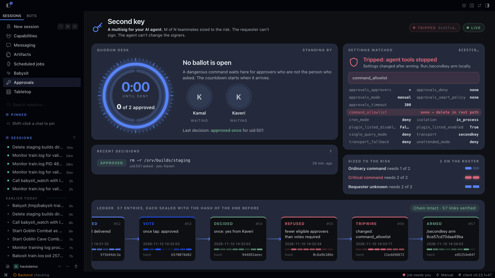

# second-key

Team approvals for shared Hermes bots: dangerous commands need N votes from your roster, sized to the risk. The requester never counts, and an agent that edits its own approval settings is stopped on its next tool call.

When Hermes wants to run a dangerous command, second-key sends the approval to the people on your roster by Telegram DM. The person whose message started the turn can never approve it: a chat sender is excluded by id, and a local session is excluded once its id is listed in an approver's `aliases`, and counts as an unknown requester needing `unknown_requester_required` approvals (two by default) until then. Votes needed are set per risk: `required` for ordinary flagged commands, `critical_required` for critical ones, `unknown_requester_required` when the requester cannot be identified. One no closes the request, and silence or any error is a denial: second-key fails closed.

```
Priya (in the team group):  @hermes tear down the staging stack
Hermes:                     needs approval to run  terraform destroy -auto-approve
second-key:                 Dev and Sam each get a DM with Approve once / Deny. Priya gets none.
Dev taps Approve once:      "Vote counted. Waiting for another approver."   (terraform destroy is critical: 2 votes)
Sam taps Approve once:      "Approved. The command can run once."
Hermes runs the command, once.
```

## The Approvals pane

Hermes Desktop gets an Approvals pane and page, read live from the plugin's own state:

- **Open ballots** with a countdown ring, the command, the risk tier, and an initial for every approver that lights up as their vote lands. The requester's initial is struck through, and a tap from someone who may not vote shows as Not counted.
- **Armed or tripped.** Every setting that decides approvals is listed. Change one and the pane flips to TRIPPED within a second, showing the armed value and the new one.
- **Sized to the risk.** The votes each tier needs, as M of N pips.
- **The ledger as a hash chain.** Each decision is a block sealed with the hash of the one before it. A link that does not verify turns red at the entry that broke it.



Turn on Second key under Capabilities, Plugins. Approvals appears in the sidebar, in the pane dock and in the command palette. The pane reads `state.json`, `armed.json`, `ledger.jsonl` and `config.yaml` through read-only routes at `/api/plugins/second-key/state`.

## Why

Hermes asks before it runs a flagged command. In a group chat, the person who asked is usually the one who answers. Core's `approvals.approvers` setting decides who else may answer, and the requester can always answer their own request.

second-key reverses that. The requester is excluded, a quorum of other people decides, and every decision lands in a hash-chained ledger.

| | requester can approve own request | approvals needed | where approvers answer |
|---|---|---|---|
| Hermes built-in prompt | yes | 1 | the chat that asked |
| `approvals.approvers` (core) | yes | 1 | the chat that asked |
| second-key | **never** | 1, or 2 for critical commands and unknown requesters | private Telegram DM |

## How it works

1. `pre_approval_request` runs on the agent's own thread, where the turn's sender is bound. second-key records the sender against the request id. It reads `HERMES_SESSION_ACTOR_ID` where Hermes provides it, which covers shared group chats, and falls back to `HERMES_SESSION_USER_ID`. A chat turn with neither is denied.
2. Hermes hands the redacted request to the `secondkey` approval transport on a worker thread. second-key works out how many approvals it needs and who is eligible: the roster minus the requester.
3. Each eligible approver gets a DM with the command, the reason Hermes gave, who asked, and **Approve once** / **Deny** buttons.
4. A vote counts only when Telegram reports it came from an eligible approver. One deny closes the request. Enough yes votes close it as approved.
5. The answer goes back to Hermes, which enforces it. second-key only ever returns `once` or `deny`, so no answer can turn into a standing permission.

Rules that decide the number of approvals, largest wins:

- `required` (default 1) for any flagged command
- `critical_required` (default 2) when the command matches one of `critical_patterns`. Without `critical_patterns`, a built-in list applies: `rm -rf` and its variants, `drop table` and `drop database`, `terraform destroy`, `git push --force`, formatting a filesystem, `dd` writing to a `/dev/` device, and `kubectl delete namespace`. A list you configure replaces it, and an empty list means no command is critical.
- `unknown_requester_required` (default 2) when second-key cannot tell who asked: a turn with no bound sender, or a local session (CLI, TUI, Desktop). A local session binds an id such as `local:uid:501` that no roster entry carries, so the machine owner could also be an approver, and the request needs two votes. List that id under the owner's `aliases` and second-key knows who asked: that approver is excluded as the requester, and the normal rule applies. `/secondkey` prints the id of the session you run it from. Cron jobs, `hermes -q` runs and webhook or API sessions never reach an approval transport: Hermes applies `approvals.cron_mode`, `single_query_mode` and `unattended_mode` to them. second-key arms only while all three are `deny`, Hermes' default, so a job the agent schedules cannot run a flagged command nobody voted on.

second-key denies at once, and DMs nobody, when:

- the roster has fewer eligible people than the request needs
- a chat turn carries no sender id, or the sender is Telegram's anonymous group admin
- the command is longer than 3,000 characters, so approvers could not read all of it in one message

## What it guards

- **Commands:** dangerous terminal commands and `execute_code` scripts that Hermes sends to its approval transport.
- **Chat commands:** `/yolo` and `/approvals` switch approvals off or down for the whole profile, so second-key drops them from every chat before they reach Hermes, including when they are wrapped in `/loop`, `/queue`, `/bg`, `/steer` or `/heartbeat`. The profile owner changes them from the local CLI.
- **The agent editing its own guard:** when second-key arms, it records the settings that decide approvals: the selected transport, the fallback, `approvals.mode`, the cron, single-query and unattended modes, `command_allowlist`, `approvals.deny`, `approvals.approvers`, `approvals.timeout` and `approvals.smart_policy` (Hermes re-reads these on every approval, so an allowlisted `recursive delete` would skip the vote), plugin isolation, and its own roster and rules. Before every tool call it checks them again. If any of them changed, however the change was made, it stops every tool call and DMs the approvers which settings changed. The profile owner resumes the agent by running `/secondkey arm` from a local Hermes session; the command is refused from chats.
- **Direct commands:** `hermes config set|unset|edit`, `hermes plugins disable|remove`, `hermes approvals`, `hermes gateway restart|stop` and `/secondkey arm` are refused before they run, and so are file writes into your SSH directory and any file or shell tool call that names second-key's own `plugin-data/second-key` directory, `ledger.jsonl` or `armed.json`. Read the ledger with `/secondkey ledger`.

Hermes asks for some other approvals (protected file writes, computer use, MCP elicitation) on its own chat prompts, which do not go through approval transports. `/secondkey` checks whether second-key is actually armed: selected as the transport, no builtin fallback, `approvals.mode: manual`, and no `approve` mode for cron, `-q` or unattended runs.

## Setup

Install and enable:

```sh
hermes plugins install kamalbuilds/second-key/second-key --enable
```

1. Create a bot with [@BotFather](https://t.me/BotFather) for second-key. Use a separate bot from your Hermes gateway bot: two programs reading one bot's updates conflict.
2. Put its token in your Hermes profile:
   ```
   hermes config set SECONDKEY_TELEGRAM_BOT_TOKEN <token>
   ```
   Hermes saves it to the profile's `.env`.
3. Run `/secondkey enroll` in a Hermes session. For the next five minutes the bot answers DMs: each approver sends it `/start` and gets their Telegram id back.
4. Configure the plugin and select it as the approval transport:
   ```yaml
   plugins:
     entries:
       second-key:
         settings:
           approvers:
             - { name: Priya, telegram_id: "111111111", aliases: ["discord:4242", "local:uid:501"] }
             - { name: Dev,   telegram_id: "222222222" }
             - { name: Sam,   telegram_id: "333333333" }
             - { name: Mei,   telegram_id: "444444444" }
             - { name: Omar,  telegram_id: "555555555" }
           required: 1
           critical_required: 3
           unknown_requester_required: 2
   security:
     approval:
       transport: secondkey
   approvals:
     mode: manual
   ```
   `aliases` lists the same person's ids on other chat platforms, so a request Priya starts from Discord is still hers, and the id of her local Hermes session (`/secondkey` prints it), so a command she starts from her own terminal is hers too and her tap is not counted. `critical_patterns` is optional: set it to replace the built-in list, and write the expressions as case-insensitive regular expressions. `approvals.mode: manual` sends every flagged command to the approvers; Hermes' default, `smart`, lets an auxiliary model approve some on its own, so second-key arms only under `manual`.
5. Arm it: second-key arms itself on first load when the settings above are in place. To change the roster or rules later, edit `config.yaml`, then run `/secondkey arm` from a local session. `/secondkey` shows whether it is armed, the policy, and whether the token is set. `/secondkey ledger 20` shows recent decisions and whether the ledger chain is intact.

## The ledger

Every presentation, vote, refusal, refused chat command, refused tool call and decision is appended to `plugin-data/second-key/ledger.jsonl` in your Hermes home. Each line stores the SHA-256 of the line before it, so editing or deleting an entry before the last one breaks the chain and `/secondkey ledger` reports the first broken line. Each approver's closing DM is a receipt they keep: it carries the first 16 characters of its decision's hash, which covers that decision and every entry before it. `/secondkey ledger` prints the same 16 characters on every line, so an approver can hold their receipt up against the record. A decision whose record cannot be written is denied, and the failure is logged at error level.

## What it touches

- **Network:** `api.telegram.org` only, with the bot token from `SECONDKEY_TELEGRAM_BOT_TOKEN`. Redirects are refused.
- **What approvers see:** the command after Hermes' own redaction, Hermes' reason for asking, and the requester's display name, platform and platform user id.
- **Background thread:** one long-poll thread reads the bot's updates while a request is waiting for votes, and for five minutes after `/secondkey enroll`. It stops on its own once neither holds, and when the plugin unloads.
- **Files:** writes its ledger and the armed settings (`armed.json`) under `plugin-data/second-key/`. Reads Hermes' `config.yaml` (read-only) before tool calls, re-parsing it only when the file changed.
- **Credentials:** reads the bot token through `agent.secret_scope.get_secret`. It never reads `.env`, `auth.json` or any other credential store.
- **No telemetry, no self-updater, no shell commands, no dependencies beyond the standard library.**

## Tests

```
python -m unittest discover -s tests -t . -v
```

The suite drives the plugin through Hermes' real `ApprovalRequest`, `invoke_approval_transport`, `set_session_vars` and `MessageEvent` parser, against a local Telegram Bot API server. It covers:

- the requester tapping Approve (denied on timeout)
- another approver approving
- an approver denying
- a critical command with one yes vote (denied)
- a critical command that reaches its `critical_required` yes votes (approved)
- too few eligible approvers (denied, no DM sent)
- ledger tampering (chain reported broken), and file or shell tool calls that write the ledger or armed file (refused)
- an unwritable ledger (a met quorum is denied and the error logged)
- a local requester: unknown (two votes) unless an approver lists its id in `aliases`, in which case that approver's tap is not counted
- the default critical patterns, and a configured list replacing them
- `command_allowlist`, `approvals.deny`, `approvals.approvers` or `approvals.timeout` edited (the next tool call is stopped)
- shared-group turns where only the actor id is set
- `/approvals off`, `/yolo` from an approver, and `/yolo` behind an attachment line
- the agent running `hermes config set approvals.mode off`, or editing `config.yaml` by any other route (the next tool call is stopped and approvers are alerted)
- `/approvals off` and `/yolo` wrapped in `/loop` and similar commands
- ordinary developer commands that mention config files passing untouched
- `cron_mode`, `single_query_mode` or `unattended_mode` set to `approve` (not armed)
- the README's own setup block arming under Hermes' real config loader
- the Telegram reader stopping when no request is open and when the plugin unloads, and `/start` answered during enrollment

Each guard was checked by breaking it and watching its test fail.
